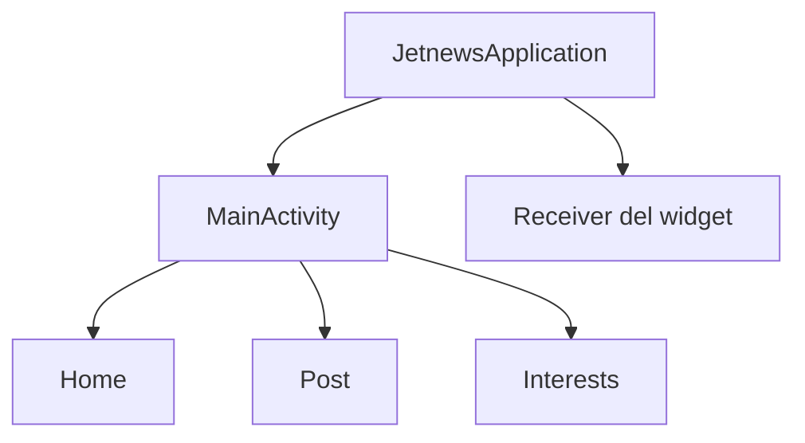

# Análisis de una app de código abierto
He realizado mi analisis sobre
https://github.com/android/compose-samples/blob/main/JetNews/app/src/main/AndroidManifest.xml
## Cuántas Activities tiene y qué destinos de navegación (pantallas) contiene, siguiendo el enfoque moderno visto en clase.

Solo tiene una MainActivity. La navegación en este caso son 3 pantallas  (Home, Post e Interests). 
Para navegar por ellos usa Navigation 3(NavKey).
## Si usa Services, Broadcast Receivers o Content Providers, y para qué.

Si, usa Receivers para escuchar al sistema y actualizar los widgets de la pantalla inicial. No usa ni Content Providers ni Services.

## Qué contiene su AndroidManifest.xml: componentes declarados, permisos solicitados, cuál es la actividad de arranque.
La MainActivity (única) y el receiver del widget. Por otro lado, la clase JetnewsApplication actua como la entrada de la app. Además inicializa las dependencias y configura los componentes globales, (como bases de datos o repositorios). JetnewApplication se crea al arrancar la app antes que la Activity.
Además vemos la actividad de arranque de la MainActivity por el intent-filter con el LAUNCHER y el MAIN.
He buscado también si pide permisos y no hay permisos (me refiero a uses-permission), y es lógico por que vienen de dentro del propio codigo de la app.

## Cómo está organizada la estructura de paquetes.
La estructura de Jetnews combina las capas (data y ui) dentro de la ui teniendo cada pantalla su propio paquete. Voy a profundizar genericamente en la siguiente tabla un poco más.

| Paquete | Contenido                                               |
|---|---------------------------------------------------------|
| `com.example.jetnews` | El paquete raíz para arrancar la app                    |
| `data` | Los datos de la app                                     |
| `deeplink` | Gestión de enlaces externos que abre la app (profundos) |
| `glance` | Es el widget de la pantalla inicio                      |
| `ui` | La interfaz principal de la MainActivity                |
| `ui.home` | La pantalla de inicio                                   |
| `ui.post` | EL articulo completo                                    |
| `ui.interests` | Los temas de interés                                    |
| `ui.navigation` | La navegación entre pantallas                           |
| `ui.theme` | La parte visual (colores, letras, temas)                |
## Diagrama
// Formato mermaid flowchart TD para github

=========================================
