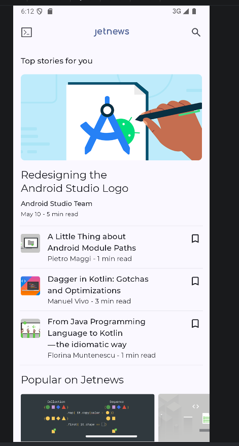
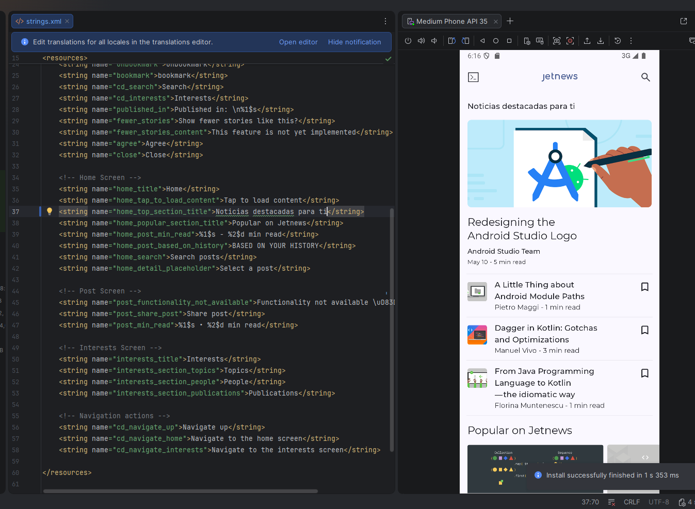
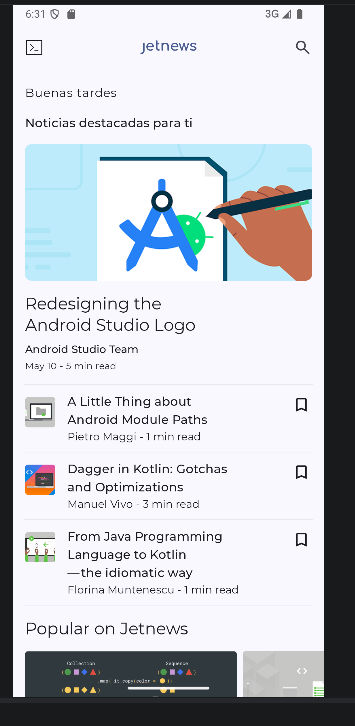

# Modificación funcional de una app existente

## Repositorio con el código
Hice un fork del repositorio oficial de Google y ambos tienen ahora commits. 
[Repositorio de app modificada](https://github.com/MauroGins/compose-samples)

## Ejecución antes del cambio

Antes de la ejecución sin tocar la app. Al principio no me compilaba por que usa una versión superior a la mía (9.3.1).  Tube que actualizarla a Rabbit 2.

## Cambio 1: texto de la sección principal

Hice un cambio muy sencillo, traduciendo un texto de inglés a castellano en /res/values/strings.xml 

## Cambio 2: saludo según la hora

Aquí fue un poco más complejo. Creé 3 nuevos textos en strings.xml , como obtiene la hora con Calendar eleige el saludo con when 
```
    val hora = Calendar.getInstance().get(Calendar.HOUR_OF_DAY)
    val saludo = when{
        hora <12 -> R.string.saludo_manana
        hora <20 -> R.string.saludo_tarde
        else -> R.string.saludo_noche}
    Text(modifier = Modifier.padding(start = 16.dp, top = 16.dp, end = 16.dp),
        text=stringResource(id=saludo))
```

## Por qué elegí estos puntos del código
Elegí estos puntos de cambio en el código siendo uno un cambio rápido (cambio de string en el xml) y luego cambiando un texto que dependía de una condicon (horaria en este caso). En ambos casos los busqué con Ctrl + Mayús + F y por el nombre descrito. Luego aproveché la ventana de strings.xml para centrarme en home_top_section_title y ya me llevó a PostListTopSection 