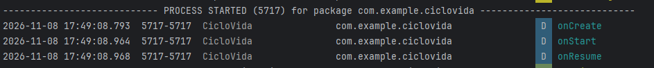
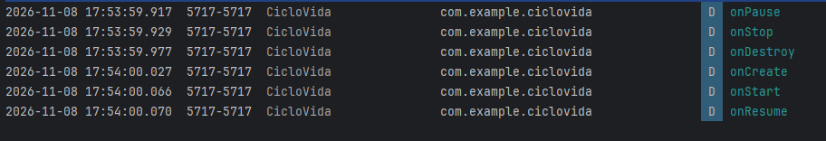
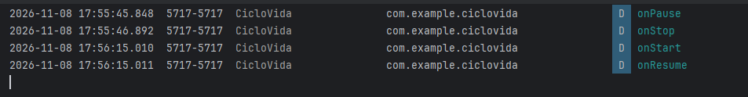
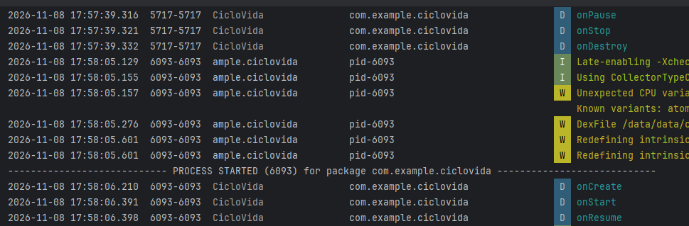
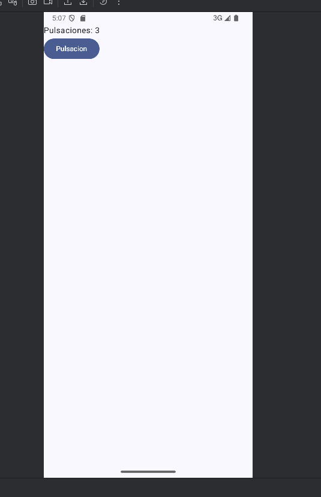
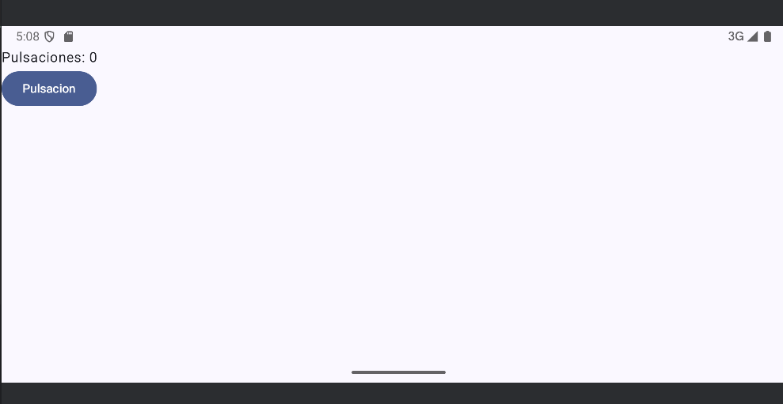
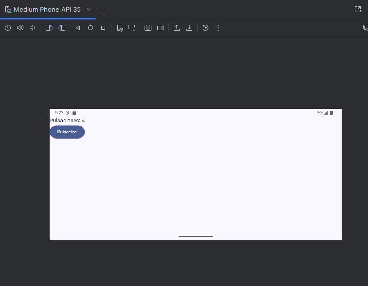
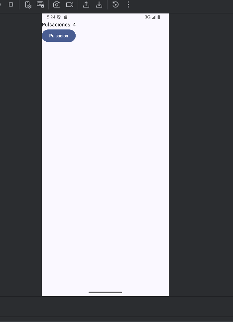

# Experimento de ciclo de vida

## Repositorio del experimento
[Repositorio del experimento](https://github.com/MauroGins/ciclovida)

## Trazas en los callbacks
```
private val TAG = "CicloVida"

```
```
    override fun onStart() {
        super.onStart()
        Log.d(TAG, "onStart")
    }

    override fun onResume() {
        super.onResume()
        Log.d(TAG, "onResume")
    }

    override fun onPause() {
        super.onPause()
        Log.d(TAG, "onPause")
    }

```
He usado una etiqueta val TAG y un Log.d en cada callback para filtrar los mensajes tag:CicloVida

## Situación 1: arranque normal

Al abrir la app se crea un proceso nuevo (PROCESS STARTED) y la Activity pasa por onCreate, onStart y onResume. Despues de onResume, la app está en primer plano podemos interactuar con ella.

## Situación 2: girar la pantalla

En el giro se destruía la activity y se volvía a crear.

## Situación 3: pulsar Inicio y volver

Aquí no pasa por onDestroy ni onCreate (activity paralizada).

## Situación 4: cerrar la app y reabrirla

Aquí pasa por onDestroy y  al reabrir hay habia un proceso nuevo (onCreate).

## Guardar el estado con onSaveInstanceState
Al girar la pantalla, el contador sufría un problema, y el contador volvía a 0.




Se solucionó guardando con putInt y recuperando el onCreate

```
    override fun onCreate(savedInstanceState: Bundle?) {
        super.onCreate(savedInstanceState)
        Log.d(TAG, "onCreate")
        if (savedInstanceState != null) {
            contador = savedInstanceState.getInt("contador")
        }
```

Ahora el número se mantiene. 


