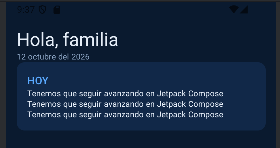

A2.4 · Hito de proyecto: esqueleto del Proyecto A

Objetivo: arrancar formalmente el desarrollo del Proyecto A definido en el tema 1.

    Crea el repositorio Git del proyecto
    Crea el proyecto en Android Studio con la estructura de paquetes que hayas decidido para tu aplicación.
    Declara en el AndroidManifest.xml al menos la Activity de arranque.
    Construye una pantalla inicial mínima (no hace falta que tenga toda la interfaz definitiva, solo debe compilar y ejecutarse).
    Crea en la raiz del proyecto una carpeta llamada docs/adr donde mantendrás todos los adr solicitados a lo largo del curso. Añade aquí el adr del tema-1 y del tema-2.
    Crea la carpeta docs/proyecto con el contenido de la plantilla del tema-1 con las especificaciones de tu proyecto, asegurate de cubrir los campos del punto 0.
    Haz el primer commit con este esqueleto y, a partir de aquí, mantén commits regulares en cada sesión de trabajo.
    Añade a ProfesorPermuta como colaborador de tu proyecto

aviso

Este hito es la base de todo lo que viene A partir de este tema, cada nueva unidad añade una capa al mismo proyecto. Un esqueleto mal organizado (paquetes desordenados, sin Git desde el principio) se paga en las unidades siguientes. Merece la pena dedicarle el tiempo necesario.

# Hito de proyecto: esqueleto del Proyecto A

## 1. Repositorio Git del proyecto
[Repositorio TwoDo en GitHub](https://github.com/MauroGins/TwoDo/tree/desarrollo)
Desarrollo: He creado la rama desarrollo para trabajar mas limpio, guardando la main como versión de estabilidad y los hitos para las "fotos de entrega"

## 2. Estructura de paquetes
| Paquete | Contenido                                                                           |
|---|-------------------------------------------------------------------------------------|
| `com.example.twodo` | Contiene la MainActivity siendo el punto de arranque de la app                      |
| `com.example.twodo.ui` | Contiene el InicioScreen.kt (y la carpeta theme) siendo esta la pantalla de inicio. |
| `com.example.twodo.ui.theme` | Contiene Color.kt y Theme.kt siendo la paleta de colores y el tema de la app.       |

Cuando la app vaya creciendo tendré que ir añadiendo más cosas dentro de la ui para organizar la interfaz por características según pantallas y así sea más fácil identificarlo y modificarlo

| Pantalla            | Paquete previsto    |
|---------------------|---------------------|
| Inicio              | ui.inicio           |
| Lista de la compra  | ui.compra           |
| Tareas de los hijos | ui.tareas           |
| Calendario          | ui.calendario       |


## 3. Activity de arranque en el AndroidManifest.xml

```xml
<activity
    android:name=".MainActivity"
    android:exported="true">
    <intent-filter>
        <action android:name="android.intent.action.MAIN" />
        <category android:name="android.intent.category.LAUNCHER" />
    </intent-filter>
</activity>
```
Tengo una única MainActivity siguiendo el mismo enfoque de clase  con las pantallas como destinos de navegación.
Tenemos el exported="true" que es necesaria para abrir la app.
El intent-filter contiene el main y el launcher que hacen que aparezca el icono de TwoDo en nuestro movil

## 4. Pantalla inicial mínima
Tengo hecha una pantalla llamada  InicioScreen,  con Jetpack Compose, con el saludo, la fecha y la tarjeta "Hoy".
La MainActivity la carga con setContent { } dentro de un Scaffold, al usar Compose.
He creado un tema propio llamado TwoDoTheme, con la paleta de colores definida en Color.kt y Theme.kt, siguiendo  la línea de azules de mi GitHub.
Además compila y se ejecuta como pide el enunciado 


## 5. Carpeta docs/adr

Creada y refactorizado todo. Antes estaba todo en una carpeta llamada Docs y ahora docs es la carpeta principal y dentro de ahí hay otras carpetas (adr y res) que mantienen los recursos de documentacion y visuales. Esto nos servirá para dejar la documentación técnica importante que se toma para el proyecto bien reflejada y ordenada.
- [0101 · Comparación de tecnologías](0101_tech_comparasion.md)
- [0102 · Puesta en marcha del entorno](0102_rollout.md)
- [0103 · Analisis de limitación de un dispositivo](0103_device_constrains.md)
- [0201 · analisis_jetnews](0201_analisis_jetnews.md)
- [0204 · esqueleto_proyecto A](0204_esqueleto_proyecto.md)
## 6. Carpeta docs/proyecto

Crada la carpeta docs/proyecto y movido a ella la [Propuesta del Proyecto A](../proyecto/plantilla-proyecto-a.md)


## 7. Commits regulares
Mis commits tras las sesiones de trabajo (solo las de trabajo real no las de trasteo a nivel personal aun que he pensado en hacer commits en una nueva rama de pruebas para que se refleje todo el trabajo)
[Historial de commits desarrollo](https://github.com/MauroGins/TwoDo/commits/desarrollo)

## 8. Colaborador
Mi colaborador es ProfesorPermuta, siendo añadido al repositorio con anterioridad.
