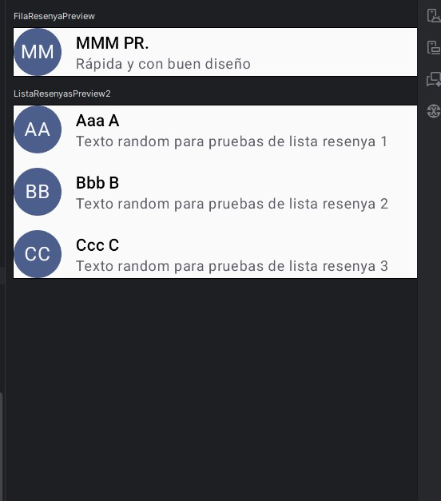

# Tarjeta de reseña

## Repositorio del código
- [Repositorio actividad 3_1](https://github.com/MauroGins/ciclovida)

## Qué composables de estructura has usado y por qué
- Row: la fila completa ya que avatar, textos y valoraciones van en horizontal.
- Box: el avatar, en forma circular ".clip(CircleShape)" en el modifier. Usar Box es para superponer las iniciales encima del circulo y poder centrarlas (en la Row y el Column se colocaría uno al lado de otro o uno debajo del otro).
- Column: Dentro de la Row para poner nombre encima de comentario. Al ser pocas reseñas y fijas he optado por una column y no una LazyColumn. También he añadido ".weight(1f)" para ocupar el espacio y poner la valoracion a la derecha.  
- Spacer: para tener hueco y distanciar el avatar y texto.

## Qué componentes comunes has usado y para qué
- Text: para nombre, comentario, valoracion y las iniciales.

## Parámetros y contenido (trailing lambda)
- Con el Box, en los parentesis() van los parámetros (tamaño, color, forma) y en las llaves{} va el contenido, en este caso las iniciales, que son la trailing lambda.
- En este apartado me pasó un detalle que tardé en darme cuenta que fue ponerlo en el medio del parentesis  y rompía el Box. El Spacer va a la misma altura de lectura que el Box

## Resultado
- 